  

  

### Sobre mim

Engenheiro de software sênior, com mais de 6 anos em backend. Trabalho com **Go** e **Python** em microsserviços e mensageria e, hoje, com **Agentic AI**: agentes de atendimento que integram LLMs a sistemas corporativos em produção, com alto volume.

- 🚀 Migração de microsserviços de Python para Go, reduzindo pela metade ou mais o uso de pods no Kubernetes
- 🤖 Agentes de IA no WhatsApp (incluindo WhatsApp Flows) integrados a serviços internos e APIs externas
- ✅ Testes automatizados e cobertura acima de 80% nos projetos principais

### Stack

  <picture>
    <source media="(prefers-color-scheme: dark)" srcset="https://skillicons.dev/icons?i=go%2Cpy%2Cdjango%2Cts%2Creact%2Cpostgres%2Credis%2Crabbitmq%2Cdocker%2Ckubernetes%2Cgithubactions%2Clinux&theme=dark">
    
  </picture>

Também: gRPC · NATS JetStream · LLMs · WhatsApp Business API · OAuth2/JWT

### Projetos

  <a href="https://github.com/Leonardoongaratto/llm-gateway"><picture><source media="(prefers-color-scheme: dark)" srcset="https://raw.githubusercontent.com/Leonardoongaratto/Leonardoongaratto/output/repo-llm-gateway-dark.svg"></picture></a>
  <a href="https://github.com/Leonardoongaratto/nexus-trading-engine"><picture><source media="(prefers-color-scheme: dark)" srcset="https://raw.githubusercontent.com/Leonardoongaratto/Leonardoongaratto/output/repo-nexus-trading-engine-dark.svg"></picture></a>
  <a href="https://github.com/Leonardoongaratto/campaign-broker"><picture><source media="(prefers-color-scheme: dark)" srcset="https://raw.githubusercontent.com/Leonardoongaratto/Leonardoongaratto/output/repo-campaign-broker-dark.svg"></picture></a>
  <a href="https://github.com/Leonardoongaratto/finance-api"><picture><source media="(prefers-color-scheme: dark)" srcset="https://raw.githubusercontent.com/Leonardoongaratto/Leonardoongaratto/output/repo-finance-api-dark.svg"></picture></a>
  <a href="https://github.com/Leonardoongaratto/finance-web"><picture><source media="(prefers-color-scheme: dark)" srcset="https://raw.githubusercontent.com/Leonardoongaratto/Leonardoongaratto/output/repo-finance-web-dark.svg"></picture></a>
  <a href="https://github.com/Leonardoongaratto/ai-dev-template"><picture><source media="(prefers-color-scheme: dark)" srcset="https://raw.githubusercontent.com/Leonardoongaratto/Leonardoongaratto/output/repo-ai-dev-template-dark.svg"></picture></a>

### Linguagens e contribuições

  <picture>
    <source media="(prefers-color-scheme: dark)" srcset="https://raw.githubusercontent.com/Leonardoongaratto/Leonardoongaratto/output/languages-dark.svg">
    
  </picture>

<picture>
  <source media="(prefers-color-scheme: dark)" srcset="https://raw.githubusercontent.com/Leonardoongaratto/Leonardoongaratto/output/github-snake-dark.svg">
  
</picture>
