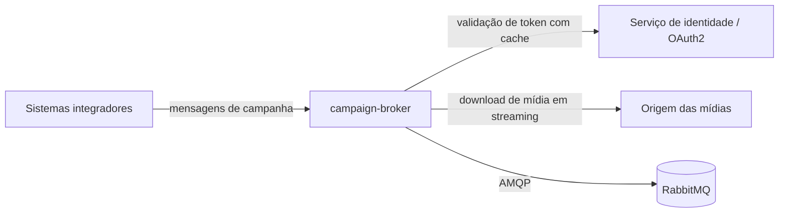

### Olá, eu sou o Leonardo 👋

Engenheiro de software sênior, com mais de 6 anos em backend. Trabalho com **Go** e **Python** em microsserviços e mensageria e, hoje, com **Agentic AI**: agentes de atendimento que integram LLMs a sistemas corporativos em produção, com alto volume.

- Migração de microsserviços de Python para Go, reduzindo pela metade ou mais o uso de pods no Kubernetes
- Agentes de IA no WhatsApp (incluindo WhatsApp Flows) integrados a serviços internos e APIs externas
- Testes automatizados e cobertura acima de 80% nos projetos principais

**Stack:** Go · Python · Gin · Django/DRF · PostgreSQL · Redis · RabbitMQ · NATS · gRPC · Docker · Kubernetes · LLMs · WhatsApp Business API

#### Projeto em destaque (Go)

| Projeto | O que é |
| --- | --- |
| [campaign-broker](https://github.com/Leonardoongaratto/campaign-broker) | Gateway de ingestão de mensagens de campanha WhatsApp: autenticação com cache de tokens, download de mídia com streaming para Base64 e publicação em filas RabbitMQ com pool de canais. CI com gate de cobertura (≥ 80%) |

#### Outros projetos

| Projeto | O que é |
| --- | --- |
| [ai-dev-template](https://github.com/Leonardoongaratto/ai-dev-template) | Governança para projetos com agentes de IA (Claude Code e Antigravity): pipeline implementer → reviewer → QA → bug-fixer e setup para Windows e Linux |
| [recipes](https://github.com/Leonardoongaratto/recipes) | Site de receitas em Django com busca, paginação e suíte de testes em pytest |
| [tourist-point-api](https://github.com/Leonardoongaratto/tourist-point-api) | API REST de pontos turísticos em Django REST Framework |

📫 [LinkedIn](https://www.linkedin.com/in/leonardoongaratto/)
